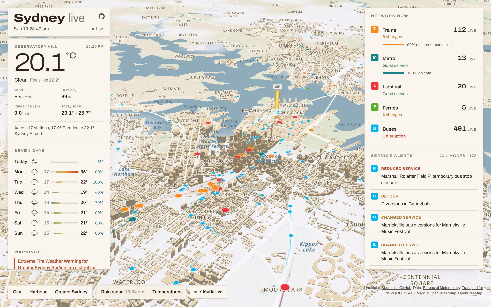

# Sydney Live

**Live: <https://sydney-live-dashboard.web.app>**

A realtime 3D dashboard of Sydney, built on open government data. Sydney is
drawn as a sandstone architectural model (3D buildings over OpenStreetMap
data). On top of it run every train, metro, light rail, ferry and bus, BoM
temperature columns for the Sydney stations and the animated rain radar.



- **Weather** (Bureau of Meteorology): latest observations from the ~20 stations
  in BoM's Sydney Metropolitan district, the 7-day Sydney forecast, current NSW
  warnings, and the last ~40 minutes of the Terrey Hills 128 km rain radar.
- **Public transport** (Transport for NSW): live vehicle positions with
  fading trails, service alerts and network status for each mode, and on-time
  performance for trains and metro computed from GTFS-realtime trip updates.

Unofficial, and not affiliated with BoM or Transport for NSW.

## Run it

Needs Node 22 or newer.

```sh
npm install
cp .env.example .env   # then paste your TfNSW key into .env
npm run dev            # http://localhost:8787
```

`npm run dev` starts Vite and, next to it, the live API under
`wrangler dev` (a local Cloudflare Worker on port 8788 that Vite proxies
`/api` to). Weather works with no setup. Live transport needs a free
Transport for NSW Open Data API key:

1. Sign up at <https://opendata.transport.nsw.gov.au> and log in.
2. Open your profile menu, choose **API Tokens**, name a token and click
   **Create API token**. Copy it straight away: it is shown once.
3. Put it in `.env` as `TFNSW_API_KEY=...` and restart `npm run dev`.

## How it works

```
BoM anonymous FTP ─┐                                     Firebase Hosting
                   ├─► Cloudflare Worker ──SSE──► browser (static site): MapLibre + deck.gl
TfNSW GTFS-RT API ─┘   + one Durable Object
                       polls, decodes, keeps the API key
```

- `server/`: a Cloudflare Worker in front of a single Durable Object. The
  object polls each upstream feed on its own schedule (driven by Durable
  Object alarms), decodes GTFS-realtime protobuf and BoM XML, and pushes JSON
  to browsers over one Server-Sent Events stream (`/api/live`). Every browser
  shares the same polls, and polling stops when the last browser leaves.
  `/api/health` reports the state of each feed.
- `src/`: MapLibre GL renders the basemap, buildings and radar. deck.gl
  owns the camera and draws vehicles, trails and station columns on top.
  Vehicles are rendered 45 seconds behind real time, so each one is always
  interpolated between two real GPS fixes instead of jumping between polls.

BoM data is read from its [anonymous FTP service](https://www.bom.gov.au/catalogue/anon-ftp.shtml),
the Bureau's published channel for automated access, over Workers TCP sockets.

## Deploy for free

The site is static, so it lives on **Firebase Hosting** on the no-cost Spark
plan. The live API cannot: Firebase only runs server code (Cloud Functions)
on the pay-as-you-go Blaze plan, which needs a billing account and has no
hard spending cap. So the API runs on the **Cloudflare Workers Free** plan
instead. Neither account has a card attached, and on both plans going over a
limit returns errors rather than a bill.

| Free limit | Allowance | What this app uses |
| --- | --- | --- |
| Firebase Hosting transfer | 360 MB/day | ~0.7 MB per first visit (repeat visits are cached), so ~500 new visitors a day |
| Firebase Hosting storage | 10 GB | ~2.5 MB per release |
| Workers requests | 100,000/day | ~10 per visit (one live stream, radar frames) |
| Durable Object requests | 100,000/day | ~6,500/day of poll alarms if someone watches 24/7 |
| Durable Object duration | 13,000 GB-s/day | at most 10,800 GB-s (one 128 MB object awake all day) |
| TfNSW API | 60,000 requests/day | at most ~41,000, shared by all visitors |

One-time setup:

```sh
npm install -g firebase-tools
firebase login
firebase projects:create <your-project-id>   # no billing account: Spark plan
npx wrangler login                           # free Cloudflare account
npx wrangler secret put TFNSW_API_KEY        # paste the key; stored by Cloudflare, never in git
```

Then point the code at your accounts (all three are currently set for the
author's deployment):

- `.firebaserc`: your Firebase project id.
- `server/worker.ts`: `ORIGINS`, the site origins allowed to read the API.
- `.env.production`: `VITE_API_ORIGIN`, the Worker URL that
  `npm run deploy:api` prints.

Deploy:

```sh
npm run deploy        # deploy:api (wrangler) then deploy:web (vite build + firebase)
```

## API usage

One Durable Object with a browser open around the clock makes about 41,000
TfNSW requests a day: 8 vehicle feeds every 20 s, 2 trip-update feeds every
minute and 5 alert feeds every 2 minutes. Any number of browsers share the
same polls, and none are made while nobody is watching.

## Data and licences

- Transport for NSW Open Data: [CC BY 4.0](https://opendata.transport.nsw.gov.au).
- Bureau of Meteorology: © Commonwealth of Australia. See the BoM
  [copyright notice](https://www.bom.gov.au/other/copyright.shtml) before
  any commercial reuse.
- Basemap tiles: [OpenFreeMap](https://openfreemap.org), with data
  © [OpenStreetMap contributors](https://www.openstreetmap.org/copyright).

Code: MIT.
